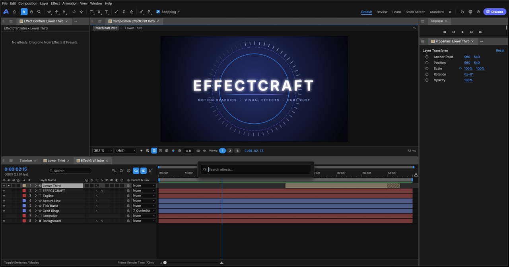
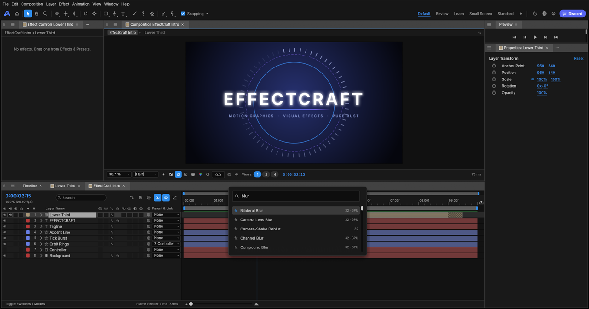
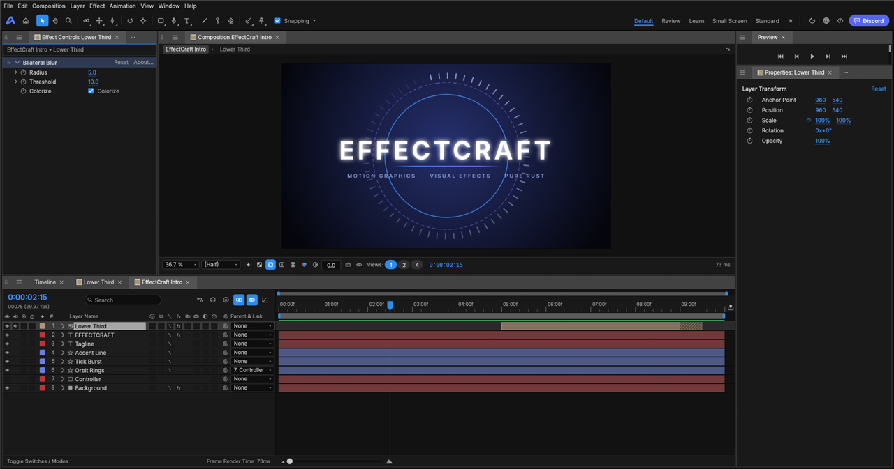

# Quick Effects Search

Quick Effects Search is a compact, non-modal palette for applying an effect or animation preset to
the selected timeline layers without leaving the current panel. It is a separate floating
`egui::Area`; it does not change any panel's layout or the app's existing controls.

## What it does

- Opens from the `effects.quickSearch` command (default: **Shift+Space**) or its menu entry.
- Starts with one empty search field: nothing is listed until you type. This keeps the palette
  small when it first appears.
- Searches **everything Effects & Presets can show**: every registered effect (name, translated
  name, id, category, aliases and parameter names), every text animation preset, every built-in
  animation preset in all categories, and the user's `.ecpreset` files. Exact names rank above
  prefixes, which rank above loose substring matches. Results are capped to five visible rows;
  the rest scroll inside the same fixed box, so the palette never grows. Effects show their
  32-bpc / GPU badges; presets show their Effects & Presets category.
- Enter (or a click) applies the highlighted result through the same engine command the panel uses:
  `effect.apply` for effects, `layer.applyTextPreset`, `anim.applyBuiltinPreset` or `anim.applyPreset`
  for presets. Effects then focus Effect Controls and are recorded in Effects & Presets ▸ Recent,
  exactly as applying from the panel does. Undo and redo work normally.
- Arrow keys move the selection; Escape or a press outside the palette closes it. A close fade
  runs before the widget is removed, and focus returns to whatever had it before opening.
- With no selected layer, Enter applies nothing and reports “Select a layer to apply to” in the
  status bar. A failed apply is not recorded as Recent.
- The palette is draggable. Its last position is saved in global preferences
  (`Prefs::quick_effects_pos`), so it reopens in the same place in a new project and after a
  restart. `UiState` keeps only the open/query/selection state, which is per project.
- Arrow keys change the highlighted result without moving keyboard focus out of the search field;
  that selection is exposed to assistive technology through each row's list-item state. Enter applies
  the highlighted result. The field and rows register automation ids (`quickEffects.search`,
  `quickEffects.item.<id>`) and accessibility roles; `quickEffects.list` is an automation rectangle
  for the visible results box, not an accessibility role.

## Changing the shortcut

The chord is **fully customizable in the app**, like any other command:

1. Open **Edit ▸ Keyboard Shortcuts**.
2. Search for **Quick Effects Search** (or find it under **Tools & Panels**).
3. Select it and record new keys, assign them from the on-screen keyboard, remove the existing
   key, or reset the command to the default.

All changes go through the existing `shortcuts.*` engine commands, so scripts and agents can
rebind it too. The palette never hardcodes Shift+Space: the dispatcher reads the active binding
table, so rebinds and cleared shortcuts take effect immediately.

`Shift+Space` is also the default for Preview. The dispatcher gives Quick Effects Search
priority so the palette opens on that chord; the shortcut editor reports the intentional
conflict before assignment. Rebinding either command removes the conflict.

## Screenshots

## Tests

- Unit tests in `crates/ui-egui/src/panels/quick_effects.rs` cover scoring, aliases, empty queries
  and the five-row search behaviour.
- Integration tests in `crates/ui-egui/tests/it/ui_quick_effects.rs` cover opening and rebinding
  the chord, real effect results, applying with Enter, undo/redo, dragging and saved position,
  closing, and the fixed compact size.
